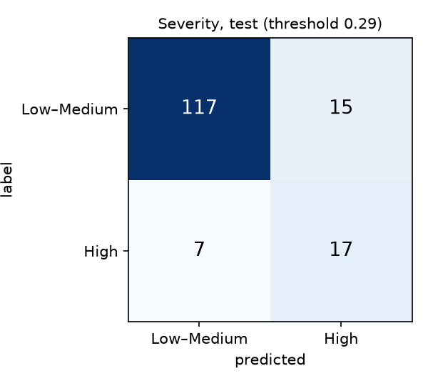
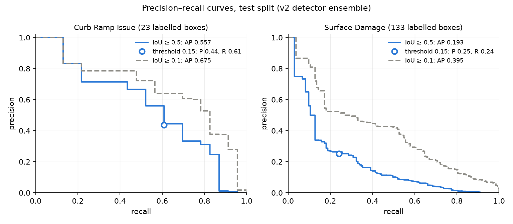
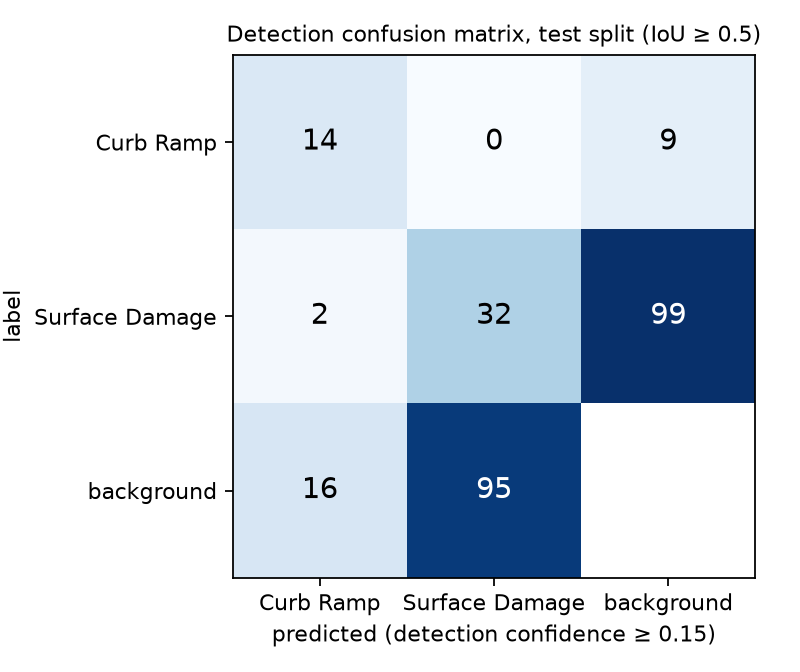
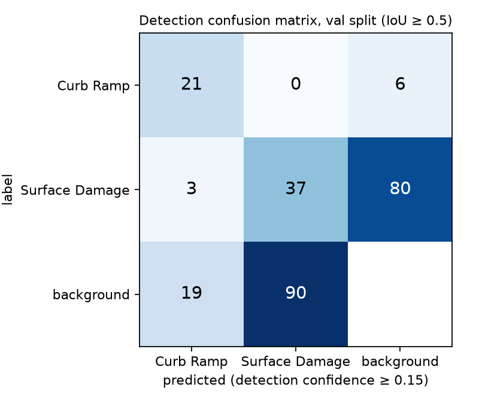
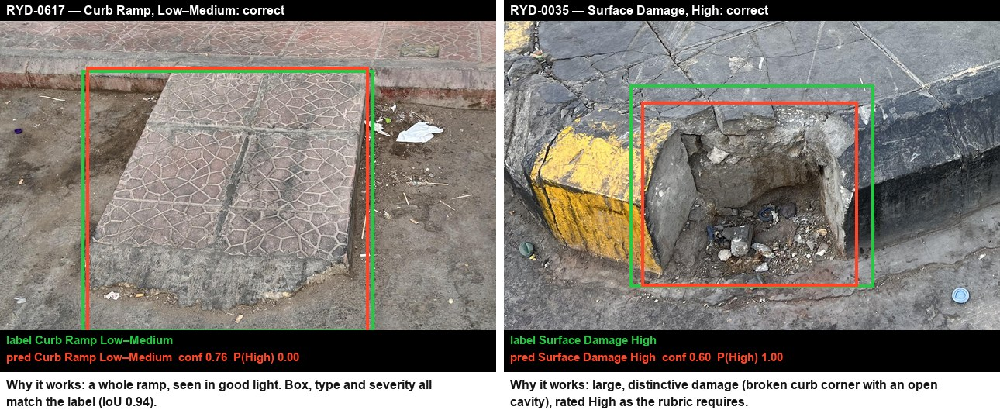
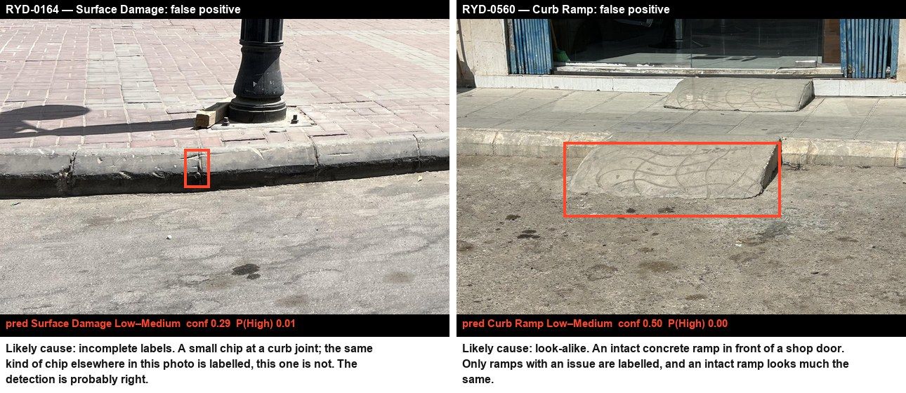
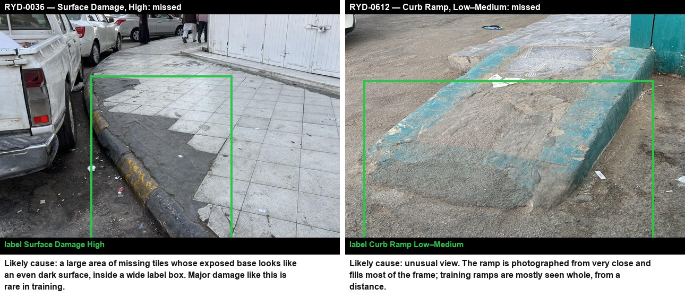
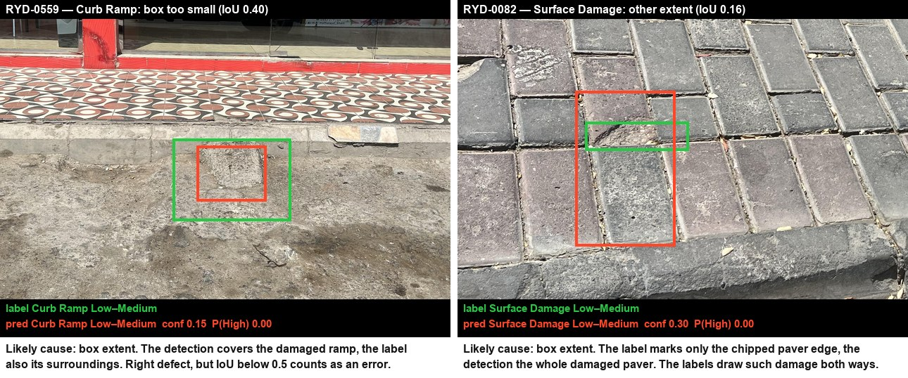
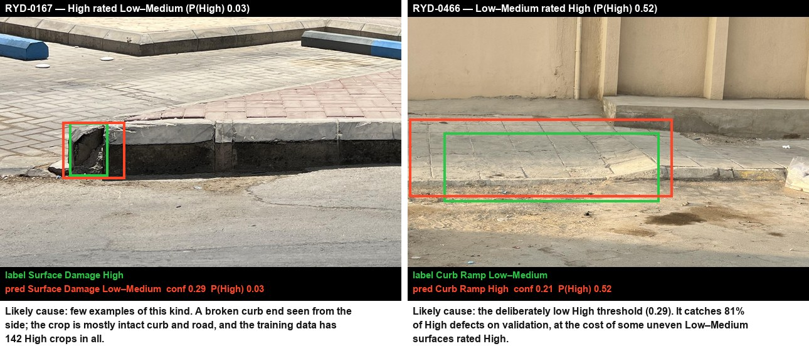

# Khota — Sidewalk Defect Detection and Severity Classification

*Markdown version of [`Khota_Project_Report.pdf`](Khota_Project_Report.pdf) — same content.*

**Project report: the work done, the results, why Surface Damage is hard and what limits Surface Damage**

23 November 2026

## Summary

The system looks at a sidewalk photo, finds every defect, says whether it is a **Curb Ramp Issue** or **Surface Damage**, and rates each defect **Low–Medium** or **High** severity. It is delivered as trained models, an inference pipeline (command line, Python and an HTTP API for the app; the detection and severity models can also be used on their own), and this report.

| metric | target / team's earlier result | baseline setup reproduced (test) | v1 (test) | v2 (val) | v2 (test) |
|---|---|---|---|---|---|
| mAP@0.5 Curb Ramp Issue | above 0.60 | 0.493 ± 0.053 | 0.610 | 0.659 | **0.557** |
| mAP@0.5 Surface Damage | above 0.60 (was 0.08) | 0.079 ± 0.006 | 0.168 | 0.233 | **0.193** |
| mAP@0.5, both classes | – | 0.286 ± 0.027 | 0.389 | 0.446 | **0.375** |
| Severity: High recall | improve on 0.587 ± 0.027 | 0.681 ± 0.048 | 0.708 | 0.808 | **0.708** |
| Severity: Macro-F1 | 0.798 ± 0.005 | 0.812 ± 0.027 | 0.753 | 0.788 | **0.761** |
| Severity: accuracy | majority baseline 0.869 | 0.902 ± 0.020 | 0.854 (maj. 0.847) | 0.857 (maj. 0.823) | **0.859 (maj. 0.846)** |

“Baseline setup reproduced” = the brief's default models (YOLOv8n 640 px; ResNet-18 at threshold 0.5) trained on the labels as delivered and scored on the same test photos; ± = standard deviation over seeds 42/43/44. v2 is the delivered model (detection confidence 0.15, High threshold 0.29, both chosen on validation). v2 is scored on the final labels; v1 and the baseline setup were scored before the last relabelling round, which changed 3 test boxes and 12 validation boxes. On the final validation labels v1 scores mAP@0.5 0.379 (Curb Ramp 0.611, Surface Damage 0.147). All mAP values use the same AP code.

* **Curb Ramp:** 0.557 on test and 0.659 on validation (target above 0.60; on test the baseline setup scores 0.49 and v1 0.61). The test split has 23 Curb Ramp boxes, so one box moves this value by several points.
* **Surface Damage improved, but is far from the target:** 0.193 on test (baseline setup 0.08, v1 0.17). The limit is the Surface Damage labels themselves (sections 5 and 9).
* **Severity:** on the labelled test defects the classifier finds 17 of 24 High defects (recall 0.708, Macro-F1 0.761); on validation 0.808 and 0.788. With 24 High defects in the test split, one defect moves recall by 0.04.
* **End to end on test:** 89% of the photos that contain a labelled defect get flagged, and 22% of photos without a defect raise a false alarm (v1: 56% and 9%).
* **Final model v2 — RF-DETR detector added:** a pre-trained detection transformer (DINOv2 backbone), fine-tuned on Khota and fused with the 7 YOLO detectors, raises validation mAP@0.5 from 0.379 to 0.446. On test it scores 0.375 against 0.389 for v1: Surface Damage improves (0.168 → 0.193), Curb Ramp does not (0.610 → 0.557), so the overall validation gain does not carry over to the test split. A difference of this size is comparable to the seed-to-seed spread on test (± 0.053 for Curb Ramp in the baseline setup), and v1 was scored before the last relabelling (3.14, 4.2).

## 1. The task

Khota's app collects sidewalk photos. The goal is to find the defects in each photo automatically and rate how serious each one is, so repairs can be prioritised without inspecting every photo by hand. The brief fixed a two-stage design:

1. **Detector (YOLO)** — finds each defect in the whole photo, draws a box and names its type: Curb Ramp Issue (class 0) or Surface Damage (class 1).
2. **Severity classifier (ResNet-18)** — looks at each detected box, enlarged 20% per side, cropped from the original photo and resized to 224 × 224, and decides Low–Medium or High.

Output per photo: a list of defects (box, type, confidence, severity, probability of High) or “No Target Defect”. Every defect is therefore one of four combinations (final labels):

|  | Low–Medium | High | total |
|---|---|---|---|
| Curb Ramp Issue | 123 | 39 | 162 |
| Surface Damage | 719 | 154 | 873 |
| total | 842 | 193 | 1,035 |

Severity follows the team's rubric: Low–Medium = SD-NS1/NS2 and CR-NS1/NS2; High = SD-H1 (missing paving with the layer below exposed, or an open cavity), SD-H2 (severe breakage with missing pieces, or a displaced slab leaving a gap), SD-H3 (path interruption), CR-H1/H2. Cracks or peeling alone are never High.

**Evaluation protocol:** split by location; choose everything on the validation split; use the test split only for the final evaluation; three seeds (42/43/44) reported as mean ± std; report every configuration tried; log every label change in the team's Excel workbook.

## 2. Data and split

Final labels; High-severity boxes in brackets. The same counts are in data/splits/split_report.json.

| split | photos | with a defect | without a defect | location groups | Curb Ramp boxes | Surface Damage boxes | all boxes |
|---|---|---|---|---|---|---|---|
| train | 482 | 345 | 137 | 112 | 112 (28) | 620 (115) | 732 (143) |
| val | 104 | 77 | 27 | 43 | 27 (6) | 120 (20) | 147 (26) |
| test | 103 | 71 | 32 | 28 | 23 (5) | 133 (19) | 156 (24) |
| total | 689 | 493 | 196 | 183 | 162 (39) | 873 (154) | 1,035 (193) |

* 689 photos from three Roboflow exports, cross-checked against the team's Excel workbook (the Boxes sheet is the authoritative label list).
* **Location split, frozen:** photos whose GPS positions are within 200 m of each other form one location group, and a group is never split across train/val/test. The same sidewalk can therefore never appear in both training and evaluation, which would inflate every score.
* 196 photos have no target defect; they stay in the detector data as background examples.
* **Label versions.** As delivered: 1,010 boxes (155 High, 194 photos without a defect). Reviewed, 18 November: 1,044 (192 High, 195). Final, 22 November: 1,035 (193 High, 196). The v2 results are scored on the final labels; 3.12 lists the labels each delivered model was trained on.

## 3. Work log — everything investigated and built

### 3.1 Data integrity check

The label files in the Roboflow exports were cross-checked box by box against the Excel workbook:

* The exports contain 693 photos; the workbook indexes 689. The 4 extra photos (RYD-0058, 0415, 0418, 0423) are marked *Excluded* by the team and were left out.
* The label files hold 1,010 boxes; the Boxes sheet has 1,000 rows. 10 label boxes have no row in the Boxes sheet and 4 rows have a missing or invalid severity (one contains a note to decide later). These 14 boxes were marked “undecided”.
* 9 rows of the older Box_Assignment sheet disagree with the Boxes sheet, 2 boxes point to the wrong photo and 1 file name was wrong (RYD-0591, fixed). 53 severities in the older Batch sheets differ from the Boxes sheet; the Boxes sheet was used.

### 3.2 Location split

A 200 m single-linkage grouping of the GPS positions gave 183 location groups, assigned to train/val/test (70/15/15 of the photos). The split was frozen in *data/splits/split.csv* before any training.

### 3.3 First round on the labels as delivered

The brief's default models were trained with three seeds: YOLOv8n at 640 px and ResNet-18. They reproduced the team's own numbers (Surface Damage mAP@0.5 0.08). A YOLOv8n trial at 1280 px was *worse* (Surface Damage 0.05, Curb Ramp 0.48), which ruled out image resolution as the cause.

### 3.4 Label review (after the team's feedback)

The team asked for the labels to be corrected before more experiments — in particular multi-box photos where every box was High. Every change is logged box by box in *Khota_Model_Final_reviewed.xlsx* (changed rows green, borderline calls amber, plus Change_Log and Review_Questions sheets).

| review step | changes | what changed |
|---|---|---|
| Multi-box photos with every box High | 11 | High → Low–Medium for boxes that meet no High code |
| Second look at borderline boxes | 10 | 9 Low–Medium → High, 1 High → Low–Medium |
| Boxes delivered as “undecided” | 14 | resolved: 6 High, 8 Low–Medium |
| Clear rubric mismatches | 28 | 27 Low–Medium → High (missing paving, open cavity, broken pieces), 1 High → Low–Medium |
| Box check | 14 | 7 boxes removed (tile joints, intact paving, a sandy median), 7 unlabelled defects added |
| Detector audit + visual check | 34 | unlabelled damage added (33 Surface Damage, 1 Curb Ramp; 3 High) |
| total | 111 | in 81 photos; 53 of them borderline calls |

* **All-High photos:** 14 photos had two or more boxes that were all High. 8 were corrected; in the other 6 (RYD-0032, 0039, 0092, 0120, 0452, 0709) every box was checked and meets a High code.
* **Detector audit:** five detectors trained on location-grouped folds scored every photo they had not seen. Their confident detections that matched no label (104) and confident class disagreements (12) were checked by eye: 34 were real, unlabelled defects and were added; the rest were look-alikes (joints, stains, wet patches, worn paint). This touched 6 validation and 5 test photos, decided by eye before any final model existed.
* **Net effect:** 1,010 → 1,044 boxes; High boxes 155 → 192. Many more boxes were under-rated (clear missing paving labelled Low–Medium) than over-rated.

### 3.5 Severity classifier experiments

* 8 configurations screened with one seed: ResNet-18 with weighted cross-entropy (baseline), class-balanced sampling, focal loss, head-only warm-up, strong augmentation with box jitter, ResNet-50, EfficientNet-B0, ConvNeXt-Tiny.
* The 4 most promising were retrained on the final labels with seeds 42/43/44.
* Single models proved unstable: validation has only 26 High crops, and High recall varies by up to ± 0.22 between seeds. Averaging models removes most of that variance.
* **Chosen on validation:** the mean High probability of 6 ResNet-18 models (weighted cross-entropy and class-balanced sampling, 3 seeds each), each also scored on the mirrored crop; High if ≥ 0.29. 0.29 gives the best Macro-F1 on validation and also keeps High recall ≥ 0.80.

### 3.6 Detector experiments

* Same recipe throughout: COCO-pretrained weights, up to 120 epochs with early stopping, cosine learning rate, default augmentation, background photos included.
* Tried on the final labels: YOLOv8n (3 seeds), YOLO26-s (3 seeds), YOLO26-m (1 seed); YOLOv8s was stopped at epoch 7 to free the GPU for YOLO26.
* Result: YOLO26-s and YOLOv8n tie on validation (0.314 ± 0.008 vs 0.317 ± 0.036); YOLO26-m and 1280 px are worse. The label corrections did not change single-model detection accuracy: YOLOv8n trained on the labels as delivered scores 0.324 ± 0.017 on the same corrected validation labels.

### 3.7 First final evaluation and a pipeline fix

The first pipeline (single YOLO26-s detector) was scored on the test split. That run exposed a preprocessing mismatch: the detector was trained on photos downscaled to 1280 px with a high-quality filter, but the pipeline passed the full 4032 px photo to YOLO, which shrinks it about 6× with a simple filter. Measured on *validation*, this cost a quarter of the Curb Ramp detections (recall at the deployed confidence 0.30 → 0.44 after the fix). The pipeline now downscales exactly like training.

### 3.8 Detector ensemble (final detector)

Combining models helped far more than choosing between them: the 7 trained YOLO detectors were fused into one ensemble (v1), with the detection confidence (0.12) chosen on validation. With the project owner's approval the test split was then scored a second time for this pipeline.

### 3.9 Reviewed labels in Roboflow

All 689 photos with the reviewed labels were uploaded to a new private Roboflow project, **khota-reviewed**, in the team's workspace. The team's original projects (khota-batch1/2/3) were not modified. The new project uses four classes so severity is visible on every box (curb-ramp-issue-high / -low-medium, surface-damage-high / -low-medium), keeps the train / valid / test split, and tags photos *changed, severity-changed, box-added, box-deleted, needs-confirmation* (42 photos) and *roboflow-differs*. The last tag marks 6 photos where the team's current Roboflow project has fewer boxes than the export we received (e.g. RYD-0045: 4 instead of 10) — mostly boxes that were “undecided” and were apparently deleted after the export; these 6 photos are checked during the relabelling.

### 3.10 Automatic relabelling attempt (pseudo-labelling)

Detectors trained on two-thirds of the training photos scanned the remaining third for Surface Damage that no label covers. They returned 107 candidates. A visual check of the 40 most confident found 8 clear defects, 9 borderline cases (small curb cracks and chips) and 23 look-alikes — manholes, tree and drain grates, painted curbs, road markings, steps. Adding these automatically would teach the model that manholes and paint are damage, so no model was retrained on them. Conclusion: the missing labels are corrected by hand.

### 3.11 Public road-damage data (RDD2022)

To add variety without more manual labelling, the models were pre-trained on **RDD2022**, a public road-damage dataset of phone photos from Japan, India, the Czech Republic, the United States and China (CC BY 4.0). 26,823 photos with 40,709 boxes were used. Their labels were mapped to the Khota scheme: longitudinal, transverse and alligator cracks became Surface Damage, Low–Medium; potholes became Surface Damage, High; other categories were ignored. RDD2022 has no curb ramps. YOLO26-s was pre-trained for 6 epochs on these photos and then trained on Khota exactly like the final detectors. The severity classifier was pre-trained on 20,997 road crops (5,997 potholes as High) and then trained on the Khota crops.

**Result on validation (final labels): no gain.** The pre-trained YOLO26-s scores mAP@0.5 0.306, against 0.302–0.323 for the same model trained from the standard starting weights. Added to the 7-model ensemble as an eighth model, it moves mAP@0.5 from 0.379 to 0.381, which is within noise. The pre-trained severity ensemble is worse: Macro-F1 0.773 against 0.788, and 0.724 when High recall is held at 0.80 or more. A likely reason is that road cracks and potholes photographed from a car look different from sidewalk damage, and the hard part of the Khota labels (where a damaged area starts and ends) is not something more road photos teach. The planned YOLOv8n pre-training was therefore stopped, and no public data is used in the final model.

### 3.12 Relabelling outcome and retraining on the final labels

**Relabelling outcome.** 300 photos (211 train, 51 validation, 38 test) were relabelled in Roboflow with fixed labelling rules. Most labels were already consistent with the rules: 49 changes in 37 photos (33 boxes redrawn, 10 removed, 3 severity changes, 2 class changes, 1 box added). They are logged in the annotation workbook like every other change (160 changes in total; 1,035 boxes now). Because so few labels changed, the pass was stopped at 300 photos.

All 7 detectors and 6 severity classifiers were retrained on the final labels with exactly the same settings, and compared with the current models on validation with the final labels. Retrained detector ensemble: mAP@0.5 0.347, against 0.379 for the current one (single retrained models were within the usual seed-to-seed spread, one YOLO26-s run was poor). Retrained severity ensemble: Macro-F1 0.776 with High recall 0.58, against 0.788 and 0.81. Combining the current and the retrained detectors (13 models) gives mAP@0.5 0.387, but the same F1 at its best detection threshold (0.388 against 0.389), at twice the processing time and model size. **The 7 YOLO detectors and 6 severity classifiers of section 3.8 were therefore kept**; v2 adds the RF-DETR detector, trained on the final labels (3.14).

**Labels used to train each delivered model.** The checkpoints were chosen on the validation photos of the same label version. Every v2 result in this report is scored on the final labels.

| delivered model | trained on | training boxes (train split, 482 photos) |
|---|---|---|
| detector_1–7 (YOLO) | reviewed labels, 18 Nov | 739: Curb Ramp 114, Surface Damage 625; 136 photos without a defect as background |
| detector_8 (RF-DETR) | final labels, 22 Nov | 732: Curb Ramp 112, Surface Damage Low–Medium 505, Surface Damage High 115; 137 photos without a defect |
| classifier_1–6 (ResNet-18) | reviewed labels, 18 Nov | 739 defect crops: Low–Medium 597, High 142 |

### 3.13 Standalone detection and severity models

The integrated pipeline was split so that each stage can also be used alone, from the same weights folder: **detection only** (photo in; boxes, type and confidence out) and **severity only** (photo plus boxes in, each box cropped exactly as in training; or one ready-made defect crop). They are available as API endpoints (*POST /detect*, *POST /severity*), Python classes (*KhotaDetector*, *KhotaSeverity*) and command-line modes. The integrated *POST /predict* is unchanged: its output was checked to be byte-identical to the previous version.

### 3.14 Pre-trained RF-DETR detector (final model v2)

**RF-DETR (final model v2).** RF-DETR is Roboflow's real-time detection transformer with a DINOv2 backbone, pre-trained by Roboflow and built for fine-tuning on small custom datasets (package rfdetr 1.12.1, Apache-2.0). The Medium size was fine-tuned on the Khota training photos with Surface Damage split into Low–Medium and High sub-classes, merged back into the two requested output classes at output. Alone it scores mAP@0.5 0.418 on validation (best mean F1 0.458), against 0.379 (F1 0.389) for the 7-YOLO ensemble. Running it also on the mirrored photo and fusing both passes, weighted 4×, with the 7 YOLO detectors gave the best validation result, chosen as the final detector: **mAP@0.5 0.446** (Curb Ramp 0.659, Surface Damage 0.233), detection threshold 0.15 chosen on validation. Surface Damage AP rises by 58% over v1 (0.147 → 0.233). The severity classifiers are unchanged.

Other experiments in the same round (validation): YOLO trained with the Surface Damage sub-classes improved the YOLOv8n trio from 0.320 to 0.353; all 17 YOLO models together reached 0.390; running the detectors at 800 px or rescaling Surface Damage boxes gave no reliable gain. For severity, DINOv2 features with a logistic probe, averaged with the ResNet-18 ensemble, raised AUC from 0.871 to 0.897 but not Macro-F1 at High recall ≥ 0.80 (0.751 against 0.788), so the severity model was kept. Inception v3 (3 seeds × 2 recipes) was also tried: alone AUC 0.83; averaged with ResNet-18, Macro-F1 0.744 at High recall 0.81 against 0.788 — no gain.

**Test split (scored once, 23 November).** v2 scores mAP@0.5 0.375 (Curb Ramp 0.557, Surface Damage 0.193) against 0.389 (0.610 / 0.168) for v1. On test, Surface Damage improves and Curb Ramp does not improve (section 4).

## 4. Results in detail

v2 = the delivered model: RF-DETR + 7 YOLO detectors and 6 ResNet-18 severity classifiers, with detection confidence 0.15 and High threshold 0.29. v2 is scored on the final labels; earlier rows were scored before the last relabelling round (3.12).

### 4.1 Severity classifier

| model | split | accuracy | Macro-F1 | High recall | High precision |
|---|---|---|---|---|---|
| always Low–Medium (majority) | val | 0.823 | 0.451 | 0 | – |
| baseline: ResNet-18, labels as delivered, threshold 0.5 (3 seeds) | val | 0.849 ± 0.004 | 0.695 ± 0.014 | 0.397 ± 0.059 | 0.613 ± 0.037 |
| **v2: 6 × ResNet-18, threshold 0.29** | val | 0.857 | **0.788** | **0.808** | 0.568 |
| always Low–Medium (majority) | test | 0.846 | 0.458 | 0 | – |
| baseline: ResNet-18, labels as delivered, threshold 0.5 (3 seeds) | test | 0.902 ± 0.020 | 0.812 ± 0.027 | 0.681 ± 0.048 | 0.692 ± 0.092 |
| v1: the same 6 × ResNet-18, before the last relabelling | test | 0.854 | 0.753 | 0.708 | 0.515 |
| **v2: 6 × ResNet-18, threshold 0.29** | test | 0.859 | **0.761** | **0.708** | 0.531 |
| one seed of the final recipe (2 models), same threshold rule | test | 0.790 ± 0.035 | 0.690 ± 0.037 | 0.722 ± 0.048 | 0.401 ± 0.054 |

Test: 156 labelled defects, 24 High. The classifier catches 17 of the 24 High defects (recall 0.708) and flags 15 Low–Medium defects as High.  On validation it catches 81% of High defects against 40% for the baseline model, at a higher Macro-F1. On test the gain is smaller; with 24 High defects one case moves recall by 0.04, so the test split neither confirms nor rules out the validation gain. To favour precision instead, raise *high_threshold* in *pipeline.json* (e.g. to 0.5).

### 4.2 Detector

Validation, mAP@0.5 (single models: ultralytics evaluator; ensembles: our AP code). Rows without “final labels” were scored before the last relabelling round.

| detector | trained on | seeds | mAP@0.5 | Curb Ramp | Surface Damage |
|---|---|---|---|---|---|
| YOLOv8n 640 (baseline specification), scored on corrected val | as delivered | 3 | 0.324 ± 0.017 | 0.564 ± 0.024 | 0.085 ± 0.018 |
| YOLOv8n 1280, scored on its own val labels | as delivered | 1 | 0.265 | 0.483 | 0.047 |
| YOLOv8n 640 | reviewed | 3 | 0.317 ± 0.036 | 0.535 ± 0.076 | 0.100 ± 0.012 |
| YOLO26-s 640 | reviewed | 3 | 0.314 ± 0.008 | 0.526 ± 0.026 | 0.103 ± 0.012 |
| YOLO26-m 640 | reviewed | 1 | 0.270 | 0.450 | 0.090 |
| 3 × YOLOv8n fused | reviewed | – | 0.338 | 0.558 | 0.118 |
| 3 × YOLO26-s fused | reviewed | – | 0.370 | 0.598 | 0.143 |
| v1: all 7 fused | reviewed | – | 0.392 | 0.636 | 0.148 |
| v1: all 7 fused, final labels | reviewed | – | 0.379 | 0.611 | 0.147 |
| RF-DETR Medium alone, final labels | final | 1 | 0.418 | 0.639 | 0.198 |
| **v2: RF-DETR (+ mirror, ×4) + 7 YOLO fused, final labels** | final / reviewed* | – | **0.446** | **0.659** | **0.233** |

* RF-DETR trained on the final labels, the 7 YOLO detectors on the reviewed labels (3.12).

Test, mAP@0.5, all rows scored with the same AP code:

| detector | seeds | mAP@0.5 | Curb Ramp | Surface Damage |
|---|---|---|---|---|
| YOLOv8n 640, labels as delivered (baseline setup) | 3 | 0.286 ± 0.027 | 0.493 ± 0.053 | 0.079 ± 0.006 |
| YOLO26-s 640, reviewed labels (single models) | 3 | 0.313 ± 0.013 | 0.526 ± 0.021 | 0.099 ± 0.007 |
| first deployed version (YOLO26-s seed 42) | 1 | 0.300 | 0.507 | 0.092 |
| v1: 7-detector ensemble | – | 0.389 | 0.610 | 0.168 |
| **v2: RF-DETR + 7 YOLO fused, final labels** | – | **0.375** | **0.557** | **0.193** |

v2 at the delivered confidence (0.15) on test: Curb Ramp precision 0.44 / recall 0.61; Surface Damage precision 0.25 / recall 0.24. AP at IoU 0.1 / 0.3 / 0.5 on test: Curb Ramp 0.68 / 0.58 / 0.56, Surface Damage 0.39 / 0.31 / 0.19. Ultralytics' own evaluator matches boxes slightly differently (baseline setup 0.285 ± 0.010, single YOLO26-s 0.292 ± 0.029), which is why one code is used for the comparison.

### 4.3 End to end (photo → defects → severity)

| v2 at the delivered thresholds (0.15 / 0.29) | val | test |
|---|---|---|
| photos with a labelled defect that get at least one detection | 66 / 77 (86%) | 63 / 71 (89%) |
| photos with no labelled defect that get a detection (false alarm) | 10 / 27 (37%) | 7 / 32 (22%) |
| Curb Ramp labels found (IoU ≥ 0.5) | 0.74 | 0.65 |
| Surface Damage labels found (IoU ≥ 0.1 / ≥ 0.5) | 0.51 / 0.34 | 0.42 / 0.26 |
| High-severity Surface Damage found (IoU ≥ 0.1) | 0.65 | 0.79 |
| severity correct on detections that match a label | 50 / 61 (82%) | 40 / 50 (80%) |

The detection confidence (0.15) maximises F1 on validation. For field screening, where a missed defect costs more than a false alarm, it can be lowered in *pipeline.json*; the trade-off should be set on validation photos (results/threshold_tables_val.xlsx).

### 4.4 Detection plots

Precision–recall curves of the v2 detector ensemble on the test split at IoU ≥ 0.5 (solid) and IoU ≥ 0.1 (dashed); the dot marks the delivered threshold 0.15. The confusion matrices count detections at confidence ≥ 0.15, matched to labels at IoU ≥ 0.5 regardless of class. The same plots for every split are in results/plots/.

### 4.5 mAP on the training photos

v2 detector ensemble, final labels, the same AP code on every split:

| split | mAP@0.5 | Curb Ramp | Surface Damage | Curb Ramp at IoU ≥ 0.1 | Surface Damage at IoU ≥ 0.1 |
|---|---|---|---|---|---|
| train | 0.845 | 0.934 | 0.756 | 0.935 | 0.829 |
| val | 0.446 | 0.659 | 0.233 | 0.700 | 0.439 |
| test | 0.375 | 0.557 | 0.193 | 0.675 | 0.395 |

mAP is **not** low on the training photos: v2 reaches mAP@0.5 0.845 on the photos it was trained on (Curb Ramp 0.934, Surface Damage 0.756), against 0.446 on validation. The low values in the run tables (about 0.3 for single YOLO models; results/val_runs_detector.csv and Appendix A) are validation results, not training results. The numbers show three things:

* **The models fit the training photos, but the fit does not carry over to new locations.** The drop from 0.845 to 0.446 is the gap between photos the models have learned and sidewalks they have never seen. With 482 training photos for this much variety of damage, this is the expected sign of too little data (section 10).
* **Surface Damage is lower than Curb Ramp even on the training photos** (0.756 against 0.934). The same kind of damage is drawn as one large box in one photo and as several small boxes in another, and no model can match both. Training stops at the best validation score, not at the closest fit to the training labels.
* **On new photos the detector often finds the damage but draws a different box.** Surface Damage AP on validation is 0.439 at IoU ≥ 0.1, against 0.233 at IoU ≥ 0.5 (training photos: 0.829 and 0.756).

### 4.6 Annotated examples

Validation photos, v2 at the delivered thresholds. Green = label, red = detection (type, severity, detection confidence, probability of High). Each panel names the likely cause.

### Correct detections (true positives)

### False positives

### False negatives (missed defects)

### Localisation errors

### Severity misclassifications

### 4.7 Inference time and memory

| device | time per photo (median) | peak RAM | RAM after loading | model loading |
|---|---|---|---|---|
| CPU only: 11th Gen Intel(R) Core(TM) i7-11800H @ 2.30GHz, 8 threads | 1.8 s (mean 1.9) | 1.7 GB | 1.3 GB | 5 s |
| GPU: NVIDIA GeForce RTX 3070 Laptop GPU | 0.6 s (mean 0.6) | 2.0 GB | 1.2 GB | 5 s |

Full v2 pipeline as the app calls it: 20 original validation photos (4032 × 3024, 3.0 defects per photo on average), timed after one warm-up photo. A server running v2 on CPU needs at least 4 GB of RAM.

## 5. Why Surface Damage detection is low

Every single model scores about 0.10 mAP@0.5 on Surface Damage (0.08 with the labels as delivered, the same as the team's own result); even the 7-model ensemble reaches only 0.15–0.17. The evidence points at the labels, not the model:

1. **Model size and resolution make no difference.** YOLOv8n at 640 and 1280 px, YOLO26-s and YOLO26-m all land between 0.05 and 0.12 on Surface Damage, while the same models on the same photos reach 0.5–0.6 on Curb Ramp. A small-object or capacity problem would improve with 1280 px or a larger model.
2. **The detector finds the damage but draws a different box than the label.** On validation, Surface Damage AP is 0.21 at IoU ≥ 0.1 but 0.09 at IoU ≥ 0.5; out of fold over all photos about half of the Surface Damage boxes are hit at IoU ≥ 0.1 but only about 20% at IoU ≥ 0.5. For Curb Ramp the numbers are almost the same. Where a damaged area starts and ends — one big box or several small ones — is drawn differently from photo to photo, so a detection on the right damage often counts as wrong.
3. **Labels are incomplete.** Checking the 70 most confident Surface Damage detections that matched no label found real, unlabelled damage in about half of them (33 boxes added). Only the most confident were checked; the rest of the data has the same gaps. A model that correctly finds unlabelled damage is counted as wrong.
4. **Automatic relabelling does not work.** The pseudo-labelling attempt (3.10) found mostly look-alikes: manholes, grates, paint, steps. The labels have to be corrected by hand, with clear rules.
5. **The class is broad and its boundary is subjective.** Surface Damage covers hairline cracks, peeling, crumbling edges, missing tiles and potholes. A quarter of the boxes cover less than 0.35% of the photo. Whether a worn tile or a small curb chip counts as damage varies from photo to photo.

> **What this means:** with the current labels no detector can score high, because many of its correct detections are counted as errors. A consistent Surface Damage relabelling is the step with a real chance of a large improvement. A target of 0.60 cannot be promised even then, but it is the only route towards it. A further option is splitting Surface Damage into “minor” (cracks, peeling) and “major” (missing or broken paving, holes), a change to the class definition in the brief. Each class would then be visually consistent, and major damage, which matters most, would likely be detected much better.

**Relabelling outcome.** 300 photos (211 train, 51 validation, 38 test) were relabelled in Roboflow with fixed labelling rules. Most labels were already consistent with the rules: 49 changes in 37 photos (33 boxes redrawn, 10 removed, 3 severity changes, 2 class changes, 1 box added). They are logged in the annotation workbook like every other change (160 changes in total; 1,035 boxes now). Because so few labels changed, the pass was stopped at 300 photos. Retraining on the corrected labels did not improve validation (3.12), and neither did public road-damage data (3.11). The remaining limit is the class definition itself, so splitting Surface Damage into minor and major damage is the recommended next step.

## 6. Deliverables

| item | where (repository) |
|---|---|
| Final model v2: 8 detectors (RF-DETR + 7 YOLO), 6 severity classifiers, settings and thresholds | inference/weights/ (model files: khota_weights_v2-2026-11-22.zip; settings: pipeline.json) |
| Inference pipeline, detector ensemble, HTTP API, command-line tool | inference/ (khota/, predict.py) |
| Standalone detection model and standalone severity model | KhotaDetector / KhotaSeverity; POST /detect, POST /severity |
| App-integration guide, sample photo and responses, Python and Flutter API examples | inference/INTEGRATION_GUIDE.md, inference/examples/ |
| Training and evaluation scripts; training settings of every delivered model | data/scripts/, detection/, severity/, evaluation/ |
| Frozen split, final labels, reviewed annotation workbook with every label change | data/splits/split.csv, data/annotations/ |
| Test and validation results, threshold tables, every training run | results/ (v1 test results: archive/v1/results/) |
| Detection plots (PR curves, confusion matrices), annotated examples, inference time and memory | results/plots/, results/examples/, results/benchmark_v2_*.json |
| Licenses and notices | [Model 2 licenses](../../Model%202/docs/LICENSES.md) and section 11 |
| Setup, usage and retraining instructions | README.md, data/README.md |
| Reports: this PDF and the same report in Markdown | docs/ |
| Previous model v1 (7 YOLO detectors), kept for rollback | archive/v1/ (model files: khota_weights_v1-2026-11-21.zip) |
| Reviewed labels for inspection (4 classes, tags) | Roboflow project khota-reviewed (private) |

## 7. Rules kept and use of the test split

* Location-based split, frozen before training; no location appears in two splits.
* Checkpoints, model choice, ensemble members, detection confidence and High threshold were all chosen on **validation** only.
* The test split was scored **three times**, each time only after every choice was fixed on validation: (1) the first pipeline (single YOLO26-s detector); (2) with the project owner's approval, v1 (7-detector ensemble and the preprocessing fix); (3) at the team's request, v2, once, with the thresholds chosen on validation (0.15 and 0.29). Nothing was tuned on test; the severity classifier is identical in all three runs.
* Seeds 42/43/44, reported as mean ± std; every configuration tried is listed in Appendix A; every label change is logged in the annotation workbook.

## 8. Research log — every step and its result

All results on the validation split (location-separated photos); every choice was made there.

| Step | Result (validation) | Decision |
|---|---|---|
| 1. Data integrity check and frozen location split (200 m groups) | 689 photos, 183 location groups, 482 / 104 / 103 | Kept for all work |
| 2. Baseline setup reproduced (YOLOv8n 640; ResNet-18, threshold 0.5) | Detection mAP@0.5 0.324 (CR 0.564, SD 0.085); severity Macro-F1 0.695, High recall 0.40 | Baseline |
| 3. Label review: 111 changes, each logged in the annotation workbook | Issue fixed in 8 of 14 photos; the other 6 checked and genuinely High | Kept |
| 4. Severity classifier: losses, balanced sampling, ResNet-18/50, EfficientNet-B0, ConvNeXt-T, seed ensembles, flip TTA | 6 x ResNet-18 ensemble: Macro-F1 0.788, High recall 0.81 (baseline 0.695 / 0.40) | Kept (final severity model) |
| 5. Detector size and resolution: YOLOv8n, YOLO26-s, YOLO26-m, 1280 px | All about 0.31 overall; Surface Damage 0.05-0.12 for every model | Showed the limit is not the model |
| 6. Pipeline preprocessing fix (1280 px, high-quality downscaling) | Curb Ramp recall at the deployed threshold 0.30 -> 0.44 | Kept |
| 7. Ensemble of 7 YOLO detectors (weighted box fusion) | mAP@0.5 0.379 (CR 0.611, SD 0.147) | Kept (v1) |
| 8. Automatic relabelling (pseudo-labels from cross-trained models) | 40 most confident: 8 real defects, 23 look-alikes (manholes, grates, paint) | Dropped |
| 9. Surface Damage relabelling in Roboflow with fixed rules (300 photos) | 49 changes in 37 photos; most labels already followed the rules | Logged; pass stopped |
| 10. Public road-damage data RDD2022 (26,823 photos) for pre-training | No gain: YOLO26-s 0.306 vs 0.302-0.323; severity worse (0.773 vs 0.788) | Dropped: road photos from a car and a different box style |
| 11. Retraining all 13 models on the corrected labels | Detector 0.347 vs 0.379; severity 0.776 vs 0.788 (run-to-run noise) | Dropped |
| 12. Larger YOLO ensembles (13 and 17 models) | 0.387 / 0.390, same F1 at the operating point, 2x slower | Dropped |
| 13. Surface Damage split into Low-Medium / High sub-classes during training | YOLOv8n trio 0.320 -> 0.353 | Kept (used for RF-DETR) |
| 14. 800 px inference; Surface Damage box rescaling | No reliable gain (0.376 vs 0.380; rescaling fragile) | Dropped |
| 15. Foundation-model features for severity (DINOv2 S/B/L) and Inception v3 | AUC up to 0.897, but Macro-F1 at High recall >= 0.80 lower (0.751 / 0.744 vs 0.788) | Dropped |
| 16. RF-DETR Medium: pre-trained detection transformer (DINOv2 backbone) | Alone 0.418 (CR 0.639, SD 0.198); best F1 0.458 vs 0.389 | Kept |
| 17. RF-DETR on the mirrored photo + fusion with the 7 YOLO (RF-DETR weighted 4x) | mAP@0.5 0.446 (CR 0.659, SD 0.233); High-severity defects caught 23% -> 38% | Final model v2 |
| 18. Second RF-DETR (another seed) | Weaker than the first on validation; not finished in time | Not used |

## 9. What limits accuracy

* **Surface Damage labels are inconsistent in extent.** The best model scores 0.43 AP when a detection only has to point at the right damage (IoU ≥ 0.1) but 0.23 when it must match the drawn box (IoU ≥ 0.5). The same kind of damage is drawn as one large box in one photo and as several small boxes in another.
* **Labels are incomplete.** About half of the most confident “false” detections that were checked were real damage nobody had labelled, so a better model is penalised for finding them.
* **The class mixes very different damage.** Hairline cracks and peeling (most boxes) share one class with missing paving and holes. Detectors trained with the two kinds separated learn them better.
* **The dataset is small for this variety.** 482 training photos with 620 Surface Damage boxes (115 High) and 112 Curb Ramp boxes. Every model family tried - YOLO of every size, a detection transformer, CNN and ViT classifiers - ends at a similar ceiling, which is the signature of a data limit, not a model limit.

## 10. What will raise accuracy: data

Fifteen model-side experiments moved Surface Damage from 0.15 to 0.23 at most. The evidence above points to the data - its size and the consistency of its labels - as the limit. The next gain will come from data:

* **More in-domain photos.** Riyadh sidewalks photographed on foot, like the app's photos: thousands of defect instances (a few thousand Surface Damage boxes, several hundred Curb Ramp boxes, and several hundred High-severity examples). Public road-damage data did not substitute for this (step 10).
* **High-quality labels.** Every defect in every photo labelled, one box per contiguous damaged area drawn tight to the damage, following fixed written rules; a second person checks a sample.
* **Separate major and minor damage.** Missing paving, holes and broken slabs (what matters for repairs) as their own class; cracks and peeling as another. For cracks, outlines (polygons) instead of boxes.
* **Grow the data in steps and measure.** Retrain after each batch of new photos and track the validation curve; the pipeline, scripts and split are ready for that (retraining is one command).

## 11. Licenses and notices

| model | origin | license |
|---|---|---|
| detector_1–7.pt — YOLO detectors (YOLO26-s, YOLOv8n, YOLO26-m) | fine-tuned from Ultralytics COCO-pretrained weights | AGPL-3.0 (Ultralytics; Enterprise License available) |
| detector_8.pth — RF-DETR Medium detector | fine-tuned from Roboflow's RF-DETR Medium weights (DINOv2 backbone by Meta) | Apache-2.0 |
| classifier_1–6.pt — ResNet-18 severity classifiers | fine-tuned from torchvision ImageNet-1k weights | BSD-3-Clause (torchvision) |

| package (inference) | version | license |
|---|---|---|
| ultralytics | 8.4.84 | AGPL-3.0 |
| ultralytics-thop | 2.2.5 | AGPL-3.0 |
| rfdetr | 1.12.1 | Apache-2.0 |
| transformers | 5.24.0 | Apache-2.0 |
| supervision | 0.32.0 | MIT |
| pydeprecate | 0.9.0 | Apache-2.0 |
| torch | 2.6.0 | BSD-3-Clause |
| torchvision | 0.21.0 | BSD-3-Clause |
| numpy | 2.4.6 | BSD-3-Clause (bundled parts: 0BSD, MIT, Zlib, CC0-1.0) |
| pillow | 13.0.0 | MIT-CMU |
| opencv-python | 5.0.0.93 | Apache-2.0 |
| polars | 2.1.0 | MIT |
| matplotlib | 3.11.2 | Matplotlib License (PSF-based) |
| pyyaml | 6.0.3 | MIT |
| psutil | 7.2.2 | BSD-3-Clause |
| requests | 2.34.2 | Apache-2.0 |
| tqdm | 4.70.1 | MPL-2.0 AND MIT |
| fastapi | 0.163.1 | MIT |
| starlette | 1.10.0 | BSD-3-Clause |
| pydantic | 2.14.3 | MIT |
| uvicorn | 0.54.0 | BSD-3-Clause |
| python-multipart | 0.0.33 | Apache-2.0 |

Training and evaluation also use scipy, scikit-learn, pandas (BSD-3-Clause), openpyxl (MIT) and the RF-DETR training extras (pytorch-lightning, torchmetrics, peft: Apache-2.0; pycocotools: BSD-2-Clause). Full list with the data sources: docs/LICENSES.md.

### Required notices

* **Ultralytics (AGPL-3.0).** The YOLO detectors 1–7 run on the Ultralytics package and were fine-tuned from Ultralytics weights, which Ultralytics distributes under AGPL-3.0. Under AGPL-3.0, software that includes this code and is distributed, or offered to users over a network (for example the app's API), must make its complete source code available under AGPL-3.0. For a closed-source product, Ultralytics sells an Enterprise License. A third option is to run v2 without the YOLO detectors: RF-DETR alone (Apache-2.0) scored mAP@0.5 0.418 on validation, against 0.446 for the full v2 ensemble. That needs a small code change, because the pipeline imports Ultralytics.
* **Apache-2.0** (RF-DETR and its weights, DINOv2, transformers, OpenCV, python-multipart, requests and others): when redistributing, include the license text and any NOTICE file of the package, and mark files you changed.
* **BSD, MIT, MIT-CMU, PSF-based and Zlib** (PyTorch, torchvision, NumPy, Pillow, FastAPI, uvicorn and others): keep the copyright notice and the license text in redistributions.
* **MPL-2.0** (part of tqdm): changes to tqdm's own files must be published under MPL-2.0. Using tqdm unchanged creates no obligation.
* **Pre-training data.** The pre-trained weights come from their publishers (Ultralytics, Roboflow, Meta, torchvision). Their training data (COCO, ImageNet-1k, DINOv2's LVD-142M) carries its own terms; the publishers release the weights under the licenses above.
* This list is a summary, not legal advice. Please have it confirmed by your legal team before a commercial release.

## 12. Annotation agreement (Cohen's kappa)

Cohen's kappa was **not calculated**. Every photo was annotated once, by the project team. The label review then corrected those labels against the rubric, with every change logged in the workbook. A corrected label is not an independent second annotation, so no annotator agreement can be computed from it. Measuring agreement needs a sample of photos labelled independently by two annotators.

## 13. Use of generative AI

* **Yes, generative AI was used to write the code.** 15–23 November 2026.
* **Files written with it:** all code in the repository: inference/khota/ (__init__.py, api.py, classifier.py, crops.py, ensemble.py, pipeline.py), inference/predict.py, inference/examples/python_api_example.py and flutter_api_example.dart, and every script in data/scripts/, detection/scripts/, severity/scripts/ and evaluation/scripts/. It also wrote the scripts that build the documentation, the threshold tables and this report, and it drafted the documentation text (README files, integration guide, this report).
* **Other use.** In the label review, the AI tool compared the existing labels with the team's rubric and proposed corrections; every applied change is logged in the Change_Log sheet of the workbook. The Surface Damage relabelling in Roboflow (49 changes) was done by hand.
* **Not written by AI.** The training-settings files in detection/configs/ and severity/configs/ were written by the training tools. Every reported number comes from running the code on the data; no result was typed in by hand.

## Appendix A — every configuration tried (validation)

Severity classifier runs. Stage A: labels as delivered (143 val crops, 24 High); B: severity-reviewed screening (143, 26); C: final labels (148, 26). “thr” = High threshold tuned on validation.

| stage | configuration | seed | AUC | Macro-F1 @0.5 | High recall @0.5 | thr | Macro-F1 @thr | High recall @thr |
|---|---|---|---|---|---|---|---|---|
| ? | inc3_balanced — | 42 | 0.771 | 0.623 | 0.462 | 0.90 | 0.679 | 0.385 |
| ? | inc3_balanced — | 43 | 0.791 | 0.706 | 0.423 | 0.30 | 0.751 | 0.538 |
| ? | inc3_balanced — | 44 | 0.803 | 0.706 | 0.731 | 0.79 | 0.750 | 0.654 |
| ? | inc3_default — | 42 | 0.776 | 0.701 | 0.462 | 0.78 | 0.719 | 0.385 |
| ? | inc3_default — | 43 | 0.770 | 0.644 | 0.500 | 0.84 | 0.717 | 0.462 |
| ? | inc3_default — | 44 | 0.826 | 0.693 | 0.615 | 0.38 | 0.706 | 0.769 |
| A | r18_default — ResNet-18, weighted cross-entropy (baseline) | 42 | 0.867 | 0.757 | 0.458 | 0.56 | 0.767 | 0.458 |
| A | r18_default — ResNet-18, weighted cross-entropy (baseline) | 43 | 0.836 | 0.709 | 0.542 | 0.56 | 0.733 | 0.542 |
| A | r18_default — ResNet-18, weighted cross-entropy (baseline) | 44 | 0.813 | 0.802 | 0.625 | 0.49 | 0.819 | 0.667 |
| B | convnext_t — ConvNeXt-Tiny, weighted cross-entropy, lr 1e-4 | 42 | 0.825 | 0.701 | 0.385 | 0.06 | 0.779 | 0.808 |
| B | effb0_default — EfficientNet-B0, weighted cross-entropy | 42 | 0.825 | 0.696 | 0.538 | 0.33 | 0.718 | 0.692 |
| B | r18_balanced — ResNet-18, class-balanced sampler + plain cross-entropy | 42 | 0.870 | 0.705 | 0.615 | 0.92 | 0.777 | 0.500 |
| B | r18_default — ResNet-18, weighted cross-entropy (baseline) | 42 | 0.838 | 0.647 | 0.423 | 0.34 | 0.719 | 0.654 |
| B | r18_focal — ResNet-18, focal loss | 42 | 0.825 | 0.734 | 0.577 | 0.43 | 0.760 | 0.731 |
| B | r18_freeze — ResNet-18, head-only warm-up 5 ep, 60 ep, lr 1e-4 | 42 | 0.826 | 0.748 | 0.654 | 0.87 | 0.767 | 0.538 |
| B | r18_strong_jit — ResNet-18, strong augmentation + 10% box jitter | 42 | 0.795 | 0.660 | 0.500 | 0.73 | 0.709 | 0.500 |
| B | r50_default — ResNet-50, weighted cross-entropy | 42 | 0.828 | 0.726 | 0.538 | 0.33 | 0.757 | 0.615 |
| C | convnext_t — ConvNeXt-Tiny, weighted cross-entropy, lr 1e-4 | 42 | 0.795 | 0.717 | 0.462 | 0.17 | 0.728 | 0.654 |
| C | convnext_t — ConvNeXt-Tiny, weighted cross-entropy, lr 1e-4 | 43 | 0.817 | 0.706 | 0.538 | 0.41 | 0.742 | 0.692 |
| C | convnext_t — ConvNeXt-Tiny, weighted cross-entropy, lr 1e-4 | 44 | 0.804 | 0.660 | 0.346 | 0.79 | 0.725 | 0.346 |
| C | r18_balanced — ResNet-18, class-balanced sampler + plain cross-entropy | 42 | 0.870 | 0.750 | 0.462 | 0.44 | 0.777 | 0.538 |
| C | r18_balanced — ResNet-18, class-balanced sampler + plain cross-entropy | 43 | 0.800 | 0.702 | 0.462 | 0.68 | 0.714 | 0.423 |
| C | r18_balanced — ResNet-18, class-balanced sampler + plain cross-entropy | 44 | 0.862 | 0.708 | 0.692 | 0.41 | 0.750 | 0.846 |
| C | r18_default — ResNet-18, weighted cross-entropy (baseline) | 42 | 0.791 | 0.743 | 0.500 | 0.75 | 0.750 | 0.462 |
| C | r18_default — ResNet-18, weighted cross-entropy (baseline) | 43 | 0.776 | 0.702 | 0.462 | 0.36 | 0.736 | 0.577 |
| C | r18_default — ResNet-18, weighted cross-entropy (baseline) | 44 | 0.836 | 0.735 | 0.654 | 0.89 | 0.768 | 0.538 |
| C | r18_focal — ResNet-18, focal loss | 42 | 0.827 | 0.728 | 0.577 | 0.47 | 0.758 | 0.654 |
| C | r18_focal — ResNet-18, focal loss | 43 | 0.785 | 0.641 | 0.462 | 0.64 | 0.725 | 0.462 |
| C | r18_focal — ResNet-18, focal loss | 44 | 0.805 | 0.688 | 0.692 | 0.51 | 0.695 | 0.692 |

Detector runs (ultralytics evaluator). “as delivered” runs were trained and validated on the labels as delivered; “final” runs on the reviewed labels. YOLOv8s was stopped at epoch 7.

| labels | model | img | seed | mAP@0.5 | Curb Ramp | Surface Damage | mAP@0.5:0.95 |
|---|---|---|---|---|---|---|---|
| as delivered | YOLOv8n | 1280 | 42 | 0.265 | 0.483 | 0.047 | 0.161 |
| as delivered | YOLOv8n | 640 | 42 | 0.332 | 0.598 | 0.066 | 0.219 |
| as delivered | YOLOv8n | 640 | 43 | 0.313 | 0.558 | 0.068 | 0.197 |
| as delivered | YOLOv8n | 640 | 44 | 0.354 | 0.603 | 0.105 | 0.242 |
| final | YOLOv8n | 640 | 42 | 0.277 | 0.455 | 0.099 | 0.182 |
| final | YOLOv8n | 640 | 43 | 0.328 | 0.543 | 0.113 | 0.198 |
| final | YOLOv8n | 640 | 44 | 0.347 | 0.606 | 0.088 | 0.222 |
| final | YOLO26-m | 640 | 42 | 0.270 | 0.450 | 0.090 | 0.166 |
| final | YOLO26-s | 640 | 42 | 0.322 | 0.547 | 0.096 | 0.197 |
| final | YOLO26-s | 640 | 43 | 0.307 | 0.497 | 0.116 | 0.206 |
| final | YOLO26-s | 640 | 44 | 0.314 | 0.533 | 0.096 | 0.190 |

Also run: five out-of-fold YOLOv8n audit detectors (60 epochs, used only to find label errors); six fold detectors inside the training split for the pseudo-labelling attempt (YOLO26-s and YOLOv8n, 80 epochs); test-time augmentation (no effect).
